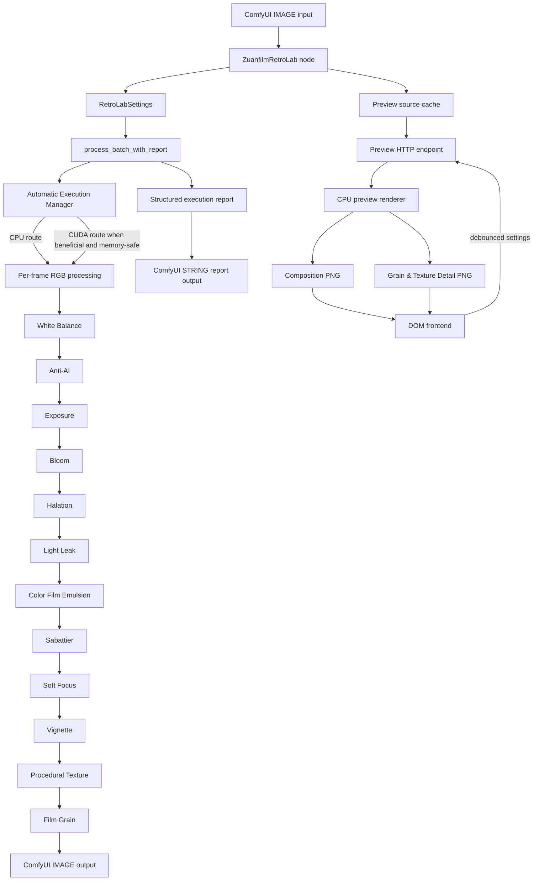

# Zuanfilm Retrolab — Engineering Architecture

## Product scope

Zuanfilm Retrolab is a post-rendering photographic finishing node for ComfyUI. It accepts a decoded ComfyUI `IMAGE`, applies primary White Balance, Anti-AI and Exposure corrections followed by a fixed sequence of photographic finishing stages, and returns an image with the same batch/spatial/channel shape, device and dtype.

The product focuses on photographic texture, light behavior, tonal reversal and optical finishing. It is not a RAW processor, a general grading suite or a chemically calibrated per-stock film simulator.

## Public node contract

- **Class:** `ZuanfilmRetroLab`
- **Node key:** `ZuanfilmRetroLab`
- **Display name:** `Zuanfilm Retrolab`
- **Category:** `Zuanfilm/RetroLab`
- **Input:** ComfyUI `IMAGE`, shape `(B, H, W, C)`
- **Outputs:** ComfyUI `IMAGE` (same shape, device and dtype in normal execution) and `STRING` (`report`, structured JSON execution diagnostics)
- **Frontend:** `js/zuanfilm_retrolab.js`
- **Preview API:** `POST /retrolab/preview`, `DELETE /retrolab/preview/{token}`

## High-level architecture



The source is organized into four responsibilities:

| Area | Responsibility |
|---|---|
| `nodes/` | ComfyUI node definition, input defaults, execution and UI token delivery |
| `core/` | Pure PyTorch processing engines, settings model, fixed pipeline and automatic execution planner |
| `preview.py` | Bounded CPU preview cache, validation of browser settings and preview HTTP endpoints |
| `js/` | ComfyUI extension, DOM controls, localization, color pickers and preview interaction |

## Processing contract and order

`core/pipeline.py` defines `RetroLabSettings`, `is_identity`, `process_single_image`, the backward-compatible tensor-only `process_batch` API and the node-facing `process_batch_with_report` API.

Fixed order:

0. White Balance (primary correction; neutral by default)
1. Anti-AI (deterministic normalization; zero by default)
2. Exposure (normalized lightness adjustment; zero by default)
3. Bloom
4. Halation
5. Light Leak
6. Color Film Emulsion
7. Sabattier
8. Soft Focus
9. Vignette
10. Procedural Texture (deterministic micro-texture; zero by default)
11. Film Grain

White Balance and Anti-AI are source corrections. White Balance applies temperature/tint gain normalization; Anti-AI applies a deterministic global tonal/chroma normalization; Exposure then adjusts overall lightness before the creative light and film stages. Bloom, Halation and Light Leak establish light/exposure behavior. Color Film Emulsion applies the selected creative negative/reversal color and tone response. Sabattier shapes tonal reversal. Soft Focus and Vignette apply spatial optical finishing. Procedural Texture adds a deterministic 2D micro-texture field after optical finishing. Film Grain is last so its particle structure is not softened by later filters.

The first three channels are treated as RGB. Additional channels pass through unchanged. Frames in a batch are processed sequentially. Grain uses a fixed internal deterministic seed plus the frame index. The user-facing Light Leak Seed controls only procedural Light Leak geometry; Light Leak remains spatially stable across batch frames.

`is_identity` returns true when all effect amounts—including Anti-AI, Exposure, Procedural Texture and Film Grain—are at zero, both White Balance axes are at zero, and Color Film Emulsion is set to Neutral. In this case, the original input tensor is returned directly without conversion, allocation or image arithmetic.

## Engine implementation notes

### Anti-AI normalization

`core/anti_ai.py` implements a deterministic global correction with Amount 0–100% (default 0%). It converts sRGB to linear RGB, evaluates Rec.709 luminance, and applies a smooth contrast compression with a subtle lower-toe lift, a broad midtone lift and a soft highlight shoulder. A soft hue/saturation mask selectively reduces red/orange chroma, with additional restrained chroma reduction in deep shadows. The correction is global and does not create local halos or use a spatial/temporal seed. Zero is an exact identity bypass. This is a creative correction for common AI-render color/tone excesses, not an image classifier or local retouching system.

### Exposure

`core/exposure.py` implements a normalized lightness control from -100 to +100 (default 0). It converts sRGB to linear RGB and uses a continuous piecewise-linear response. Negative values blend the source toward black; -100 retains 5% of source linear-light RGB. Positive values blend toward white; +100 covers 95% of the remaining distance to white. The adjustment preserves the RGB channel relationship through linear-light blending, remains bounded, and returns the original tensor unchanged at zero. Exposure is applied after Anti-AI and before Bloom so downstream light effects respond to the adjusted image lightness. This is a creative normalized lightness control, not an EV-based camera exposure model.

### Bloom

Bloom extracts highlights using a soft-knee threshold and creates a multi-scale optical glow. Its Amount range is 0–3 and Threshold defaults to 0.1. The pure-black guard avoids a nonzero glow when the input contains no light. Broad blur operations use the shared scaled Gaussian primitive to bound kernel size and working resolution.

### Halation

Halation uses an annular response with a normalized Fresnel/TIR-inspired kernel and an outward scattering tail. The `halation_color` setting controls the normalized linear-RGB emission tint. The default `#FF9959` preserves the established red-dominant response. The implementation parameters are fixed approximations rather than per-stock calibration data.

### Light Leak

Five deterministic modes are supported: Soft Edge, First-Frame Burn, 120 Fat Roll, Light Piping and Holga 135. Low-resolution seeded Torch grids and seeded geometry parameters drive the organic boundary and track structure. Leak Position defaults to Bottom. Light Leak Seed defaults to 27, is exposed as an integer slider from 0–999 and controls only the procedural geometry. Exposure is 0–10; Influence Radius is 0.25–10 and scales inward propagation distance and spectral attenuation together. The radius default of 1.0 preserves the original footprint.

The same leak geometry is reused across batch frames to avoid spatial flicker. Eight edge/corner positions are supported. Holga 135 corner selections resolve to the corresponding film edge.

### Color Film Emulsions Atlas

`core/emulsions.py` contains exactly 50 named creative profiles grouped as 10 Cinema, 10 Instant, 10 Slide / Reversal and 20 35mm Color Negative entries. A separate `neutral` entry is a strict identity bypass. `color_emulsion` is appended to the backend input contract, while its localized, grouped DOM selector is placed directly below the Preview panel; this keeps the previous backend widget indices stable. The visible selector uses a viewport-level popup portal anchored below its trigger so the long profile list does not open upward over the preview; scrolling the list keeps it open, while scrolling the page or graph closes the popup.

Each profile is an immutable parameter set: exposure offset, S-curve contrast, saturation, toe lift, shoulder compression, RGB channel gains and shadow/highlight tint vectors. The transform converts sRGB to linear RGB, maps luminance, recombines using one common luminance ratio, adjusts saturation and applies tonal color biases before converting back to sRGB. It is deterministic and uses no random values. The selected emulsion is applied to both full-resolution output and the reduced After composition preview. The Before view remains the untouched source. Grain & Texture Detail applies Procedural Texture and Film Grain at source scale and is not color-emulsion processed.

**Emulsion Response** is an independent multiplier for the complete profile deviation, not a global saturation or contrast control. Its range is 0.50×–3.00×, default 1.00×. The profile is evaluated through the established transform first, then its linear-light output is scaled around the exact image entering the emulsion stage:

`L_out = L_in + response × (L_profile − L_in)`

At 1.00× the response blend is skipped, preserving the established profile output exactly. Values below 1.00× interpolate toward the stage input; values above 1.00× extrapolate the complete tonal and color signature before the existing linear-to-sRGB output conversion and bounds. Neutral returns the original tensor directly and ignores Emulsion Response at every setting. The control introduces no random behavior and does not alter the independent Film Grain or Procedural Texture stages. The reduced After composition preview uses the same response; Grain & Texture Detail remains a separate source-scale texture inspection and is intentionally not emulsion-processed. The backend widget is appended to preserve existing serialized workflow indices; older workflows receive the 1.00× default.

### White Balance gain wheel

`core/white_balance.py` implements the primary correction exposed through the two-axis wheel beside the emulsion selector. `white_balance_temperature` ranges from cool (-1) to warm (+1) on the vertical axis; `white_balance_tint` ranges from green (-1) to magenta (+1) horizontally. The puck begins at the exact neutral center. The transform converts sRGB to linear RGB, applies restrained red/green/blue channel gains, and divides those gains by their Rec.709-weighted neutral luminance so the correction does not introduce an unintended global exposure change. It is applied before the creative finishing engines and before the selected emulsion. The frontend presents the wheel with a double graduated white/silver/graphite metallic rim, a restrained inner bevel, a small graphite-grey movable cursor and a central reference puck. Its live Cool/Warm and Green/Magenta labels plus signed values appear in a readout column to the right of the disc; the `WHITE BALANCE` label is aligned in the same control section as the **Base WB** reset button. The centered maker mark uses the descriptor `ANALOG FILM INSPIRED`. The WB reset is labelled **Base WB** because it returns the wheel coordinates to zero; it does not estimate or auto-correct white balance. This is a Resolve-inspired creative correction model, not a Kelvin-calibrated camera RAW white-balance transform or an implementation of DaVinci Resolve's internal color science.

These profiles are independently authored creative interpretations informed by public film-family descriptions, not measured stock characterization. They do not reproduce spectral sensitivity curves, sensitometric response, lab processing, scanner profiles or chemical development. The atlas does not add film grain or procedural micro-texture; those remain independent finishing stages.

### Sabattier

Sabattier computes linear Rec.709 luminance, applies a non-monotonic highlight reversal and recombines the result with a shared RGB ratio. The visible controls are Solarization and Highlight Confinement. The legacy `mackie_lines` field remains in the backend settings/input contract but is hidden from the current frontend interface.

### Soft Focus

Soft Focus calculates a resolution-aware Gaussian blur in linear RGB and blends it back over the original image with a smooth aspect-correct radial mask. The center remains sharp while the blur contribution rises toward the corners. Amount is 0–1 and Radius is 1–80 reference pixels at a 1024-pixel long edge.

### Vignette

Vignette creates an aspect-correct radial distance field normalized from the image center to the corners. Feather controls the smooth exposure-falloff transition. The exposure multiplier is applied in linear RGB. Amount is 0–2, reaching up to three stops of attenuation at the corners.

### Procedural Texture

`core/noise_texture.py` implements twelve deterministic 2D image-space texture families: Gaussian, Value fBm, Gradient fBm, Simplex fBm, Ridged fBm, Worley Microcells, Domain Warp, Silver Halide Clumps, Emulsion Mottle, Film Scratches, Dust & Fibers and Paper Foxing. The kernels are bounded and use a stable integer hash for seeded sampling. Value/gradient/simplex families are accumulated as normalized fractal sums; Worley uses nearest feature-point distances; Domain Warp displaces sampling coordinates with decorrelated gradient-fBm fields. Silver Halide Clumps modulates a fine Gaussian carrier by layered simplex clump density; Emulsion Mottle combines broad, middle and fine fields; Film Scratches uses sparse, irregular longitudinal marks; Dust & Fibers uses seeded particles and fine oriented fibres; Paper Foxing creates irregular clustered stains, pores and restrained warm ochre discolouration. The former Gabor Texture option is no longer exposed; old serialized selections migrate to Emulsion Mottle.

`noise_amount` ranges from 0–2 and defaults to zero. The 0–1 portion retains the previous strength mapping; the expanded upper half allows up to twice the prior maximum contribution. `noise_seed` ranges from 0–999 and defaults to 73. `noise_scale` ranges from 0–4.0 and defaults to 1.0; it is a feature-size multiplier, with higher values producing broader marks and lower values producing finer detail. Zero is valid and resolves to a small internal 0.05 feature-size floor to avoid a zero-frequency division while exposing the finest supported sampling interval. The `noise_blend_mode` setting offers twelve image-compositing modes: Additive, Multiply, Screen, Overlay, Soft Light, Hard Light, Color Dodge, Color Burn, Lighten, Darken, Difference and Exclusion. Additive is the default and preserves the preceding release’s original texture response. The blend mode affects only Procedural Texture. The Noise Seed is independent from Light Leak Seed and the fixed internal Film Grain seed. Light Leak Seed is an integer slider from 0–999 (default 27). For crop alignment, all kernels use reference-image dimensions and absolute source-pixel coordinates; batch frames derive deterministic seed offsets. Procedural Texture is applied after Vignette and before Film Grain. The reduced Composition preview bypasses it; the native-resolution Grain & Texture Detail view applies Procedural Texture before Film Grain.

### Film Grain

Film Grain uses counter-based integer hashing of pixel coordinates, channel stream, fixed internal grain seed and batch-frame index. It supports correlated grain, finer less-correlated settings at small Size values, and a luminance-dependent amplitude. `color_grain` interpolates between shared luminance grain and independent RGB grain. `grain_blend_mode` offers the same twelve modes as Procedural Texture and defaults to Additive, preserving the previous grain response. Both engines use the shared pure-PyTorch compositing primitives in `core/blending.py`; the blend selection is independent for each stage, and the new Film Grain input is appended to the backend widget contract to preserve older serialized widget positions.

## Color management and numeric behavior

The input RGB values are interpreted as sRGB-encoded display-referred values. Light/exposure operations that model emitted or attenuated light convert to linear RGB for computation and return to the expected image representation. Sabattier uses linear Rec.709 luminance. Grain is applied in display-referred RGB with luminance-dependent amplitude. All engines clamp or normalize their intermediate values according to their local contract, and output is checked by the test suite for finite values and supported bounds.

In normal operation, the output matches the input tensor's device and dtype. CPU-origin images may be moved one frame at a time to CUDA when the workload is large enough and a conservative free-VRAM preflight succeeds; completed frames return to CPU. CPU-only PyTorch remains fully supported. If CUDA allocation fails during a selected CUDA run, the partial batch is discarded and the entire batch is retried on CPU. If an input that was already CUDA-resident requires this exceptional fallback, the returned tensor is CPU-resident. The preview path intentionally uses CPU-resident reduced tensors and does not allocate preview processing tensors on CUDA.

## Automatic execution and memory policy

`core/execution.py` provides `ExecutionPlan`, `select_execution_plan`, a conservative per-frame CUDA working-set estimate and CUDA allocation-failure recognition. It is an internal runtime service only: the node adds no device selector, CUDA toggle, performance mode or VRAM control.

The planner follows these rules:

- Identity settings return the original IMAGE tensor before querying any execution hardware.
- Non-CPU input tensors remain on their incoming device during normal execution.
- CPU-only PyTorch, unavailable CUDA contexts and failed CUDA preflight all select CPU without interrupting node execution.
- CPU-origin workloads stay on CPU below the transfer threshold: 8 million pixels for simple pointwise corrections and 2.5 million pixels when spatial effects are active.
- Larger CPU-origin workloads are eligible for CUDA only when `torch.cuda.mem_get_info()` reports enough free memory after a reservation of at least 1 GiB or 10% of total VRAM, whichever is larger.
- The workspace estimate uses full RGB float32 frame bytes, an effect-aware multiplier capped at 14, and a fixed 128 MiB allowance. This is a conservative admission estimate, not a promise of exact allocator usage.
- CUDA work processes one batch frame at a time. Only the RGB channels are transferred to the working device; additional channels are copied directly to the output. CPU-origin outputs remain CPU-resident.
- A recognized CUDA allocation failure discards the incomplete CUDA output, releases unused allocator cache, and retries the complete batch on CPU. Other processing errors propagate normally rather than being hidden by fallback.

The planner does not change effect mathematics, enable reduced precision, modify global PyTorch precision/thread settings, or introduce external dependencies. All active photographic calculations continue to use the existing float32 internal path. The preview renderer remains independently CPU-based.

## Execution Report output

The node appends a ComfyUI `STRING` output named `report` after the existing `IMAGE` output. The original IMAGE socket remains output index 0; the report is output index 1. The socket is a workflow output only and adds no creative controls, serialized widgets, frontend panels, files or automatic logging destinations.

`core/pipeline.py::process_batch_with_report` returns the normal IMAGE tensor plus a JSON-formatted report using schema `zuanfilm.retrolab.execution-report.v1`. The report includes:

- Product/schema identifiers and UTC report timestamp.
- Input and output BHWC shape, resolution/megapixels, batch size, channel count, dtype, device and input contiguity.
- Planned and actual processing devices, planner reason, frame strategy, identity bypass state, full-resolution pipeline wall time, average time per frame and megapixel throughput. The timing explicitly excludes preview-cache construction, frontend rendering and upstream/downstream graph nodes.
- Active photographic stages in pipeline order.
- CUDA availability and probe errors, device name and query errors, CUDA runtime version, total/free VRAM at preflight, estimated one-frame working set, reserved headroom, usable VRAM after reserve, and before/after PyTorch allocator/global-memory snapshots when those queries were relevant and available.
- Whether CUDA allocation failure triggered whole-batch CPU retry, including the captured error string.
- The complete `RetroLabSettings` value snapshot, Python/PyTorch/platform versions, logical CPU count and PyTorch intra/inter-op thread counts, plus any best-effort telemetry errors.

Memory reporting is deliberately precise about its limits: the working-set number is the planner's estimate, while allocator and global memory values are snapshots. The report does not claim a measured per-node peak allocation. CUDA telemetry is best-effort; a telemetry query failure cannot make a successfully processed image fail. Identity executions do not probe hardware and explicitly report `identity_bypass` with CUDA availability as unknown/not probed.

The report is returned directly through the `STRING` socket. Retrolab does not automatically write report files. The backward-compatible tensor-only `process_batch` API remains available and does not collect report telemetry unless `process_batch_with_report` is explicitly used.

## Interactive preview architecture

A normal node execution creates a random 128-bit preview token. The preview cache stores only:

1. A reduced RGB composition proxy downsampled to a maximum 512-pixel long edge. The proxy is stored before effects; composition rendering applies White Balance, Anti-AI, Exposure and the photographic finish while bypassing Procedural Texture and Film Grain.
2. A native-resolution center crop up to 240 × 240 pixels, with a surrounding context margin for procedural texture and Film Grain. This dedicated view applies Procedural Texture followed by Film Grain at source scale.

The first preview request for a token also returns a PNG of the untouched reduced composition proxy. The frontend retains that small PNG data URL for the lifetime of the token and uses it for the Before state. Later slider requests omit the original PNG and return only the current processed composition and Grain & Texture Detail images. The comparison never transfers or retains the full-resolution source frame.

The full-resolution source frame is not retained in the preview cache. The node returns the token in its UI payload as `retrolab_preview_id` alongside the unchanged IMAGE result. The frontend receives this token through ComfyUI's node `onExecuted` callback.

```mermaid
sequenceDiagram
    participant N as Retrolab Node
    participant C as CPU Preview Cache
    participant U as DOM UI
    participant A as Preview API
    N->>C: Store composition proxy + grain crop/context
    N-->>U: retrolab_preview_id
    U->>A: First POST settings + include_original
    A->>C: Resolve preview token
    A->>A: Render composition without Film Grain
    A->>A: Render Grain & Texture Detail with Procedural Texture + Film Grain
    A-->>U: Original PNG once + processed PNGs
    U->>U: Cache original PNG in browser
    U->>U: Before / After switch changes visible composition
    U->>A: Later POST settings (without original PNG)
    A-->>U: Updated processed PNGs only
    U->>U: Update After image; preserve selected view
    U->>A: DELETE token on node removal
```

The top Composition preview deliberately omits Procedural Texture and Film Grain so reduced-resolution display does not exaggerate their microtexture. The Before / After switch beside the Live Preview heading displays either the untouched reduced input proxy or the processed composition. The original proxy is sent once per token and cached only in browser memory; effect changes do not retransmit it. Grain & Texture Detail applies Procedural Texture followed by Film Grain to the centered 240 × 240 crop at source scale. This separation does not affect the full-resolution IMAGE output, which still applies both texture stages in the normal processing pipeline. White Balance, Anti-AI, Exposure and the selected Color Film Emulsion are included in the Composition After render. Anti-AI does not alter Grain & Texture Detail; Procedural Texture and Film Grain appear together in Grain & Texture Detail. The cache holds at most six entries and expires each entry after 30 minutes. `POST /retrolab/preview` validates and clamps browser-supplied settings before rendering. `DELETE /retrolab/preview/{token}` releases the entry when the node is removed. Preview updates do not queue the graph or rerun upstream nodes. Queue the node again when the source image changes, because the preview source was created during its last execution.

Preview creation and rendering are fail-open: a preview failure must not interrupt the full-resolution IMAGE processing path. If the token is expired, the frontend asks the user to queue the node once to refresh the preview source.

## Frontend architecture

`js/zuanfilm_retrolab.js` registers the Retrolab extension and creates non-serialized DOM widgets for:

- the top Live Preview composition panel and globe-icon language selector;
- a non-serialized Before / After switch with a per-token original proxy cache;
- the Color Film Emulsions selector, first below the preview;
- the two-column Bloom / Halation control group, with Halation Color in the right column;
- the two-column Anti-AI / Sabattier row, with Strength and Exposure stacked on the left and Sabattier on the right;
- a compact two-column Light Leak control group with three paired rows: Mode / Position, Exposure / Seed, and Radius / Color;
- section dividers and the two-column Soft Focus / Vignette group;
- Reset to Defaults directly under the language selector, per-parameter hover guidance localized across all ten interface languages, a one-time zoom-aware initial node width, paired Film Grain / Procedural Texture controls with the twelve-mode Texture Blend selector, and centered Grain & Texture Detail preview.

Standard 1 px region separators are non-serialized ComfyUI DOM widgets with explicit 1 graph-unit minimum and maximum heights; the default DOM-widget minimum is 50 graph units and must be overridden or a thin divider expands into a thick band. The emphasized 2 px white boundary above Film Grain / Procedural Texture is part of that region DOM layout and remains independent. The six Light Leak controls are rendered together in one non-serialized two-column DOM widget. The visible layout pairs Mode with Position, Exposure with Seed, and Radius with Color; all six original backend widget names, values, callbacks and serialized ordering remain unchanged. The three numeric controls are hidden native widgets mirrored by translated DOM sliders, and Reset / workflow restoration synchronizes the custom controls from their canonical backend values. The language preference is stored in browser-local storage, never as a ComfyUI widget value. White Balance temperature and tint are backend numeric values appended after `color_emulsion`, and the non-serialized wheel writes them through ComfyUI widget callbacks. Translated Light Leak labels map back to the canonical option values expected by the processing node. The visible DOM controls update their corresponding backend widgets through ComfyUI callbacks so the graph and serialized node state remain synchronized. A newly created Retrolab node receives a one-time initial width in the extension-level `nodeCreated` hook, after its constructor and DOM-widget setup have completed. The starting width targets approximately 480 CSS pixels using the active canvas zoom, with a bounded 640–1600 LiteGraph graph-unit range. The zoom is sampled once; there are no persistent minimums, geometry wrappers, draw-loop corrections or repeated animation-frame checks. Subsequent canvas zooming, manual resizing and dimensions restored from saved workflows remain under LiteGraph/user control. The White Balance wheel/readout group is anchored to the right edge of its half-column with a 1 px gap.

## Performance and memory behavior

- The photographic processing stages, Anti-AI correction, procedural texture kernels and primary White Balance correction use PyTorch tensor operations and PyTorch FFT where required.
- No SciPy, OpenSimplex, Numba or POT dependencies are required.
- Grain fields are generated from deterministic integer hashes; batch frames are processed sequentially. Output batches are preallocated and populated frame-by-frame to avoid retaining a Python list of completed frames before a second full-batch stack allocation.
- `core/execution.py` selects CPU or CUDA invisibly, using workload thresholds and conservative free-VRAM budgeting. Before the first CUDA route on a runtime/device signature, a small compatibility preflight exercises representative float32 arithmetic, int64 deterministic-index arithmetic, convolution, max pooling, replicate padding, FFT, interpolation and error-function operations. Successful checks are cached per PyTorch/runtime/device signature; failed checks are not cached and select CPU before user-image transfer. The compatibility status and any reason for fallback are included in the execution report. CUDA-origin or CPU-origin processing uses the same photographic pipeline and float32 calculations; CPU-origin offloads return to CPU after each completed frame.
- Broad Bloom and Soft Focus blur use a scaled Gaussian primitive to bound convolution kernels and working resolution.
- Halation reduces its working resolution above 1536 pixels and processes color channels sequentially through FFT convolution.
- The Halation kernel cache is bounded to six entries.
- Pillow is used only to encode the small preview outputs as PNG; it is supplied by the ComfyUI runtime and is not added to `requirements.txt`.

## Determinism

The same input, dimensions, settings, seed, device and PyTorch environment produce repeatable output. Exact equality across different devices or library versions is not guaranteed for floating-point interpolation and FFT operations.

## Validation

The repository includes CPU tests for identity bypass, batch/channel preservation, deterministic processing, effect behavior, parameter boundaries, preview cache validation, preview rendering and route registration. `tests/test_frontend.mjs` provides a mocked frontend interaction test for node registration, DOM controls, localization, color pickers, reset behavior, preview refresh and widget interaction.

Automated tests do not replace a real ComfyUI host run. GPU performance and the actual ComfyUI frontend should be validated in the target installation before a production release.


Exposure response refinement: negative values retain the established linear darkening curve; positive values use a 2.5-power ease-in for a gentler low/midrange response while preserving the +100 endpoint at 95% of the remaining linear-light distance to white.
